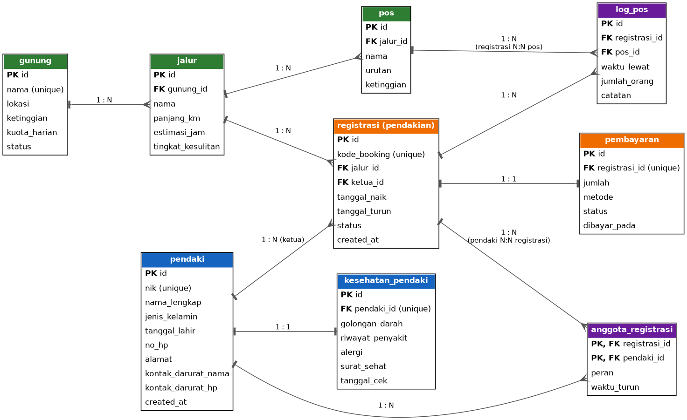

# API Pendataan Pendaki

REST API untuk mengelola data pendaki, gunung, dan pendakian. Backend digunakan untuk menyimpan, menampilkan, mencari, mengubah, dan menghapus data yang diperlukan. Dibuat dengan Node.js, Express, dan PostgreSQL (Neon/Supabase), di-deploy di Vercel.

Dibuat oleh **Oktaviani Ramadhani** (21114022610038) sebagai Tugas Akhir Learning Labs: Backend Development.

| Info | Keterangan |
| --- | --- |
| URL Deployment | https://pendaki-be.vercel.app . vercell .app . vercell .app |
| Repository | https://github.com/loopygoopyoo-ui/pendaki-be |
| ERD | `erd.png` (source: `erd.dot`) |
| Skema SQL | `schema.sql` |
| Bukti pengujian | `postman_collection.json` |

## Daftar Isi

1. [Skema Database](#skema-database-9-tabel)
2. [Cara Menjalankan di Lokal](#cara-menjalankan-di-lokal)
3. [Deployment](#deployment)
4. [Pengujian](#pengujian)
5. [Aturan Umum](#aturan-umum)
6. [Daftar Endpoint](#daftar-endpoint-15-function)
7. [Dokumentasi Detail](#dokumentasi-detail)

## Skema Database (9 tabel)



Semua tabel memiliki primary key dan saling terhubung lewat foreign key.

| Relasi | Tabel |
| --- | --- |
| 1:N | gunung → jalur → pos; jalur → registrasi |
| 1:1 | pendaki ↔ kesehatan_pendaki; registrasi ↔ pembayaran |
| N:N | pendaki ↔ registrasi (`anggota_registrasi`); registrasi ↔ pos (`log_pos`) |

Pada API, **pendakian** = tabel `registrasi`. Pendaki yang mendaftar otomatis tercatat sebagai ketua rombongan di `anggota_registrasi`.

## Cara Menjalankan di Lokal

1. `npm install`
2. Salin `.env.example` menjadi `.env`, isi `DATABASE_URL` dengan connection string Neon/Supabase.
3. Jalankan isi `schema.sql` di SQL Editor Neon/Supabase.
4. `npm run dev` → API berjalan di http://localhost:3000

## Deployment

- API di-deploy di Vercel (konfigurasi di `vercel.json`) dan bisa diakses lewat URL publik di atas.
- `DATABASE_URL` disimpan sebagai **Environment Variable** di dashboard Vercel, tidak ada password atau secret key di repository (`.env` masuk `.gitignore`).
- Database memakai Neon/Supabase yang bisa diakses dari internet.

## Pengujian

Seluruh endpoint diuji lewat Postman menggunakan URL Vercel. Import file `postman_collection.json` ke Postman, lalu ganti variabel base URL dengan URL deployment.

## Aturan Umum

- Format request dan response: JSON. Untuk POST/PUT/PATCH gunakan header `Content-Type: application/json`.
- Status code: `200` sukses, `201` data dibuat, `400` input salah, `404` tidak ditemukan, `409` data duplikat / masih dipakai data lain, `500` error server.
- Bentuk error: `{ "error": "pesan" }`.
- Tanggal memakai format `YYYY-MM-DD`.
- `PUT` dan `PATCH` sama-sama mengubah field yang dikirim saja.
- Rute `/pendaki/cari` dan `/gunung/cari` didefinisikan **sebelum** `/pendaki/:id` dan `/gunung/:id` supaya kata `cari` tidak dianggap sebagai `id`.

## Daftar Endpoint (15 function)

| No | Function | Method | URL | Kegunaan singkat |
| --- | --- | --- | --- | --- |
| 1 | tambahDataPendaki | POST | `/pendaki` | Menambah data pendaki baru |
| 2 | getDataPendaki | GET | `/pendaki` | Menampilkan seluruh data pendaki |
| 3 | getDataPendakiById | GET | `/pendaki/:id` | Menampilkan satu pendaki berdasarkan ID |
| 4 | ubahDataPendaki | PUT / PATCH | `/pendaki/:id` | Mengubah data pendaki |
| 5 | hapusDataPendaki | DELETE | `/pendaki/:id` | Menghapus data pendaki |
| 6 | cariDataPendaki | GET | `/pendaki/cari?q=` | Mencari pendaki berdasarkan nama atau ID/NIK |
| 7 | tambahDataGunung | POST | `/gunung` | Menambah data gunung |
| 8 | getDataGunung | GET | `/gunung` | Menampilkan daftar gunung |
| 9 | cariDataGunung | GET | `/gunung/cari?nama=` | Mencari gunung berdasarkan nama |
| 10 | tambahDataPendakian | POST | `/pendakian` | Menambah data pendakian baru |
| 11 | getDataPendakian | GET | `/pendakian` | Menampilkan seluruh data pendakian |
| 12 | getDataPendakianByGunung | GET | `/gunung/:id/pendakian` | Menampilkan pendakian pada gunung tertentu |
| 13 | ubahDataPendakian | PUT / PATCH | `/pendakian/:id` | Mengubah data pendakian |
| 14 | hapusDataPendakian | DELETE | `/pendakian/:id` | Menghapus data pendakian |
| 15 | getRiwayatPendakian | GET | `/pendaki/:id/pendakian` | Menampilkan riwayat pendakian seorang pendaki |

## Dokumentasi Detail

### 1. tambahDataPendaki

- **Method:** POST
- **URL:** `https://pendaki-be.vercel.app . vercell .app/pendaki`
- **Deskripsi:** Menambahkan data pendaki baru ke database
- **Header:** `Content-Type: application/json`
- **Request Body:**

```json
{
  "nik": "3322010303000003",
  "nama_lengkap": "Andi Pratama",
  "jenis_kelamin": "L",
  "tanggal_lahir": "2002-03-03",
  "no_hp": "081211112222",
  "alamat": "Tegal",
  "kontak_darurat_nama": "Ibu Andi",
  "kontak_darurat_hp": "081233334444"
}
```

Wajib: `nik`, `nama_lengkap`, `jenis_kelamin` (`L` / `P`), `tanggal_lahir`, `no_hp`, `kontak_darurat_nama`, `kontak_darurat_hp`. Opsional: `alamat`.

- **Response Sukses (201):**

```json
{
  "message": "Data pendaki berhasil ditambahkan",
  "data": {
    "id": 3,
    "nik": "3322010303000003",
    "nama_lengkap": "Andi Pratama"
  }
}
```

- **Response Error:**
  - `400`: `{ "error": "Field nik wajib diisi" }`
  - `409`: `{ "error": "Data duplikat: ada nilai unik (misalnya NIK) yang sudah dipakai" }`

### 2. getDataPendaki

- **Method:** GET
- **URL:** `https://pendaki-be.vercel.app/pendaki`
- **Deskripsi:** Menampilkan seluruh data pendaki yang tersimpan
- **Header:** -
- **Response Sukses (200):**

```json
{
  "data": [
    { "id": 1, "nik": "3322010303000001", "nama_lengkap": "Budi Santoso" },
    { "id": 3, "nik": "3322010303000003", "nama_lengkap": "Andi Pratama" }
  ]
}
```

### 3. getDataPendakiById

- **Method:** GET
- **URL:** `https://pendaki-be.vercel.app/pendaki/:id`
- **Deskripsi:** Menampilkan data seorang pendaki berdasarkan ID
- **Header:** -
- **Response Sukses (200):** `{ "data": { "id": 3, "nik": "...", "nama_lengkap": "Andi Pratama", ... } }`
- **Response Error:** `404` `{ "error": "Data pendaki tidak ditemukan" }`

### 4. ubahDataPendaki

- **Method:** PUT / PATCH
- **URL:** `https://pendaki-be.vercel.app/pendaki/:id`
- **Deskripsi:** Mengubah data pendaki yang sudah tersimpan (hanya field yang dikirim)
- **Header:** `Content-Type: application/json`
- **Request Body (contoh):**

```json
{
  "no_hp": "081299998888",
  "alamat": "Slawi"
}
```

- **Response Sukses (200):** `{ "message": "Data pendaki berhasil diubah", "data": { ... } }`
- **Response Error:**
  - `400`: `{ "error": "Tidak ada field yang diubah" }`
  - `404`: `{ "error": "Data pendaki tidak ditemukan" }`
  - `409`: `{ "error": "Data duplikat: ada nilai unik (misalnya NIK) yang sudah dipakai" }`

### 5. hapusDataPendaki

- **Method:** DELETE
- **URL:** `https://pendaki-be.vercel.app/pendaki/:id`
- **Deskripsi:** Menghapus data pendaki berdasarkan ID
- **Header:** -
- **Response Sukses (200):** `{ "message": "Data pendaki berhasil dihapus" }`
- **Response Error:**
  - `404`: `{ "error": "Data pendaki tidak ditemukan" }`
  - `409`: `{ "error": "Pendaki masih dipakai data pendakian" }`

### 6. cariDataPendaki

- **Method:** GET
- **URL:** `https://pendaki-be.vercel.app/pendaki/cari?q=andi`
- **Deskripsi:** Mencari data pendaki berdasarkan nama atau NIK
- **Header:** -
- **Response Sukses (200):** `{ "data": [ { "id": 3, "nama_lengkap": "Andi Pratama", ... } ] }`
- **Response Error:** `400` `{ "error": "Parameter q wajib diisi" }`

### 7. tambahDataGunung

- **Method:** POST
- **URL:** `https://pendaki-be.vercel.app/gunung`
- **Deskripsi:** Menambahkan data gunung (nama gunung, lokasi, dan ketinggian)
- **Header:** `Content-Type: application/json`
- **Request Body (contoh):**

```json
{
  "nama": "Gunung Slamet",
  "lokasi": "Jawa Tengah",
  "ketinggian": 3428
}
```

- **Response Sukses (201):** `{ "message": "Data gunung berhasil ditambahkan", "data": { "id": 1, "nama": "Gunung Slamet", ... } }`
- **Response Error:**
  - `400`: `{ "error": "Field nama wajib diisi" }`
  - `409`: `{ "error": "Data duplikat: gunung sudah ada" }`

### 8. getDataGunung

- **Method:** GET
- **URL:** `https://pendaki-be.vercel.app/gunung`
- **Deskripsi:** Menampilkan daftar gunung yang tersimpan
- **Header:** -
- **Response Sukses (200):** `{ "data": [ { "id": 1, "nama": "Gunung Slamet", ... } ] }`

### 9. cariDataGunung

- **Method:** GET
- **URL:** `https://pendaki-be.vercel.app/gunung/cari?nama=slamet`
- **Deskripsi:** Mencari data gunung berdasarkan nama
- **Header:** -
- **Response Sukses (200):** `{ "data": [ { "id": 1, "nama": "Gunung Slamet", ... } ] }`
- **Response Error:** `400` `{ "error": "Parameter nama wajib diisi" }`

### 10. tambahDataPendakian

- **Method:** POST
- **URL:** `https://pendaki-be.vercel.app/pendakian`
- **Deskripsi:** Menambahkan data pendakian baru (pendaki, jalur/gunung yang didaki, dan tanggal pendakian). Pendaki yang mendaftar otomatis menjadi ketua rombongan.
- **Header:** `Content-Type: application/json`
- **Request Body (contoh):**

```json
{
  "id_pendaki": 3,
  "id_jalur": 1,
  "tanggal_naik": "2026-11-10",
  "tanggal_turun": "2026-11-12"
}
```

- **Response Sukses (201):** `{ "message": "Data pendakian berhasil ditambahkan", "data": { "id": 1, ... } }`
- **Response Error:**
  - `400`: `{ "error": "Field id_jalur wajib diisi" }`
  - `404`: `{ "error": "Pendaki atau jalur tidak ditemukan" }`

### 11. getDataPendakian

- **Method:** GET
- **URL:** `https://pendaki-be.vercel.app/pendakian`
- **Deskripsi:** Menampilkan seluruh data pendakian yang tersimpan
- **Header:** -
- **Response Sukses (200):** `{ "data": [ { "id": 1, "tanggal_naik": "2026-11-10", ... } ] }`

### 12. getDataPendakianByGunung

- **Method:** GET
- **URL:** `https://pendaki-be.vercel.app/gunung/:id/pendakian`
- **Deskripsi:** Menampilkan data pendakian pada gunung tertentu
- **Header:** -
- **Response Sukses (200):** `{ "data": [ ... ] }`
- **Response Error:** `404` `{ "error": "Data gunung tidak ditemukan" }`

### 13. ubahDataPendakian

- **Method:** PUT / PATCH
- **URL:** `https://pendaki-be.vercel.app/pendakian/:id`
- **Deskripsi:** Mengubah informasi data pendakian yang sudah tersimpan (hanya field yang dikirim)
- **Header:** `Content-Type: application/json`
- **Request Body (contoh):**

```json
{
  "tanggal_turun": "2026-11-13"
}
```

- **Response Sukses (200):** `{ "message": "Data pendakian berhasil diubah", "data": { ... } }`
- **Response Error:**
  - `400`: `{ "error": "Tidak ada field yang diubah" }`
  - `404`: `{ "error": "Data pendakian tidak ditemukan" }`

### 14. hapusDataPendakian

- **Method:** DELETE
- **URL:** `https://pendaki-be.vercel.app/pendakian/:id`
- **Deskripsi:** Menghapus data pendakian berdasarkan ID
- **Header:** -
- **Response Sukses (200):** `{ "message": "Data pendakian berhasil dihapus" }`
- **Response Error:** `404` `{ "error": "Data pendakian tidak ditemukan" }`

### 15. getRiwayatPendakian

- **Method:** GET
- **URL:** `https://pendaki-be.vercel.app/pendaki/:id/pendakian`
- **Deskripsi:** Menampilkan riwayat pendakian berdasarkan data seorang pendaki
- **Header:** -
- **Response Sukses (200):** `{ "data": [ ... ] }`
- **Response Error:** `404` `{ "error": "Data pendaki tidak ditemukan" }`
